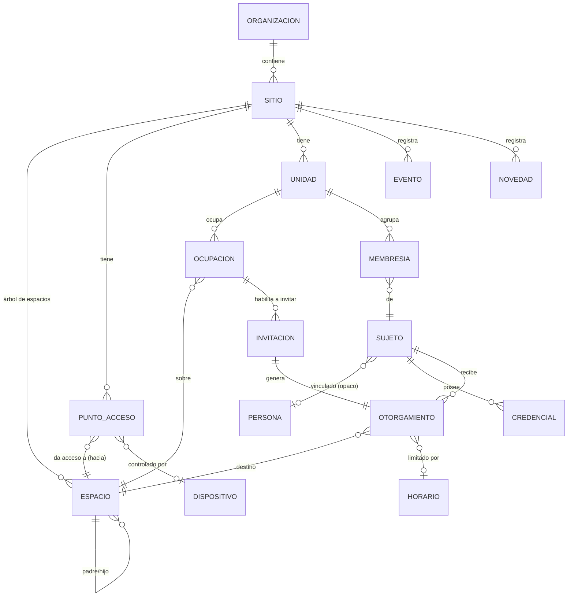

# 02 Dominio y modelo de datos

## Vista general



## Los conceptos clave

| Concepto | Qué es | Ejemplo |
|---|---|---|
| **Persona** | Identidad única en toda la plataforma (padrón). Datos cifrados, ningún tenant la ve. | Marcelo, DNI 30.123.456 |
| **Sujeto** | Representación local de alguien en un sitio. Es lo que usan todas las tablas operativas. Puede apuntar a una Persona o ser anónimo. | "Delivery 14:32" o el residente del 5B |
| **Unidad** | Entidad que ocupa un espacio y agrupa personas. | Familia, empresa, lote, departamento |
| **Espacio** | Nodo del árbol físico. | Sitio → Torre A → Piso 5 → Depto 5B |
| **Membresía** | Sujeto ↔ Unidad, con rol y vigencia. | Titular, cónyuge, hijo, empleado |
| **Ocupación** | Unidad ↔ Espacio, con rol y vigencia. | Propietario, inquilino, residente |
| **Otorgamiento** | Permiso único: Sujeto → Destino → Horario → Vigencia → Origen. | Empleada doméstica, 5B, L-V 8 a 17 |

> La clave de la privacidad: las tablas de negocio solo guardan `SujetoId`. Solo el módulo **People** conoce la relación Sujeto ↔ Persona, y nunca la expone a otros tenants (ver [06](06-privacidad-y-legal.md)).

## Árbol de espacios y puntos de acceso

- `Espacio` es un árbol por sitio (tabla con `padre_id` y un `path` tipo `ltree`). La raíz es de tipo sitio y sin padre, y la crea el administrador como primer espacio del sitio; los puntos del perímetro dan acceso a la raíz. Tipos: sitio (solo la raíz), torre, piso, unidad, área común, estacionamiento, lote y zona. Hasta 10 niveles debajo de la raíz.
- Un `PuntoAcceso` (puerta, portón, barrera, molinete, ascensor) tiene un solo atributo espacial importante: **hacia qué espacio da acceso**. El modo de fallo se elige siempre de forma explícita.
- **Derivación del camino a un destino:** los puntos permitidos para llegar al espacio *E* son todos los puntos cuyo `hacia` sea *E* o alguno de sus **ancestros**. Es una consulta sobre el árbol, sin grafos: el `path` de *E* ya tiene los identificadores de sus ancestros (`GET /api/v1/spaces/{id}/access-path`).

Ejemplo para llegar al Depto 5B:

```
Sitio (portón principal)  →  Torre A (puerta del hall)  →  Piso 5 (ascensor/puerta de piso)  →  5B (puerta del depto)
```

Un otorgamiento al **Hall** cubre solo el portón y la puerta del hall, no los pisos.

## Esquema por módulo

Cada módulo tiene su propio **schema** de PostgreSQL. Todas las tablas de los módulos con datos de negocio llevan `organizacion_id` (y `sitio_id` cuando corresponde), con RLS por tenant.

Los nombres de tablas y columnas de este documento están en español como referencia conceptual. En la base se usan en inglés, según la regla de identificadores del proyecto: `organizacion_id` es `organization_id`, `sitio_id` es `site_id`, y así con el resto. Los módulos ya implementados muestran sus nombres reales.

### Tenancy (implementado)

Schema `tenancy`.

| Tabla | Campos principales |
|---|---|
| `organization` | id, name, status (active), created_at. El plan comercial queda para un cambio posterior. |
| `site` | id, organization_id, type (building, gated_community, company, house), name (único por organización sin distinguir mayúsculas), time_zone (IANA), configuration (jsonb), created_at, updated_at |

`site` tiene la política RLS estándar por `organization_id`. `organization` tiene políticas propias: se lee y modifica solo la organización activa, y solo se crea en una operación de plataforma. Ver `openspec/specs/tenant-isolation`.

### Identity (implementado)

Schema `identity`.

| Tabla | Campos principales |
|---|---|
| `user_account` | id, email, normalized_email (único), password_hash, status (active, disabled), platform_operator, created_at. El vínculo con el Sujeto (`sujeto_ref`) llega con `add-people-registry`. |
| `membership` | id, organization_id, user_id (único por organización), created_at |
| `role_assignment` | id, organization_id, user_id, role (administrator, guard, resident, employee), scope_type (organization, site, space), scope_id (el sitio o el espacio), valid_from, valid_until, created_at |
| `invitation` | id, organization_id, normalized_email, role, scope_type, scope_id, token_hash, expires_at, accepted_at, accepted_by, created_by, created_at |
| `refresh_session` | id, user_id, active_organization_id, created_at, expires_at, revoked_at |
| `refresh_token` | id, session_id, user_id, token_hash, created_at, used_at |

`membership`, `role_assignment` e `invitation` tienen la política RLS estándar por `organization_id`; `membership` además deja ver al usuario sus propias membresías. `user_account`, `refresh_session` y `refresh_token` tienen RLS aislado por usuario: una cuenta sirve para varias organizaciones (D-04). Las búsquedas previas a la autenticación usan funciones `SECURITY DEFINER` acotadas. Los tokens se guardan solo como hash. Ver `openspec/specs/tenant-isolation` y `openspec/specs/authentication`.

Un alcance de espacio (`scope_type` = space) cubre ese espacio y todos sus descendientes, y permite leer el sitio que lo contiene, pero nunca gestionarlo. Un espacio usado como alcance de una asignación o de una invitación pendiente no se puede eliminar. El operador de plataforma es una marca de la cuenta, no un rol de organización.

### People (padrón global, fuera de RLS)

| Tabla | Campos principales |
|---|---|
| `persona` | id (opaco), estado, creado_en |
| `persona_identificador` | persona_id, tipo_documento, pais_emisor, hash_hmac (índice único), valor_cifrado |
| `persona_dato_verificado` | persona_id, nombre_cifrado (para verificación en puerta por guardia) |
| `sujeto_vinculo` | sujeto_id, persona_id (solo lo ve el módulo People) |

### Spaces (implementado)

Schema `spaces`.

| Tabla | Campos principales |
|---|---|
| `space` | id, organization_id, site_id, parent_id (nulo solo en la raíz), path (`ltree`), type (site, building, floor, unit, common_area, parking, lot, zone), name (único entre hermanos sin distinguir mayúsculas), is_common, created_at, updated_at. Llegan con sus cambios: modo de presencia (ninguno, suave, duro), aforo máximo, cupo de invitados por unidad (reservado) y restricción por morosidad. |
| `access_point` | id, organization_id, site_id, name (único en el sitio sin distinguir mayúsculas), type (door, gate, barrier, turnstile, elevator), to_space_id, from_space_id (opcional), fail_mode (fail_safe, fail_secure), created_at, updated_at. El dispositivo que lo controla vive en Devices (`device_access_point`). |

Las dos tablas tienen la política RLS estándar por `organization_id`. Las claves foráneas compuestas con `site_id` garantizan en la base que el padre, el destino y el origen son del mismo sitio, y con `ON DELETE RESTRICT` impiden eliminar un espacio con hijos o puntos relacionados. Ver `openspec/specs/space-tree` y `openspec/specs/access-points`.

### Occupancy (sujetos implementados)

Schema `occupancy`. El registro mínimo de sujetos llegó adelantado con `add-access-evaluator`; el resto llega con `add-occupancy-model`.

| Tabla | Campos principales |
|---|---|
| `subject` (implementado) | id, organization_id, site_id, kind (person, anonymous), alias, created_by, created_at, updated_at. Sin datos personales; el vínculo con el padrón llega con `add-people-registry` |
| `unidad` | id, sitio_id, tipo, nombre, estado_financiero (al_dia, moroso) |
| `ocupacion` | id, unidad_id, espacio_id, rol (propietario, inquilino, residente, titular_empresa), desde, hasta |
| `membresia` | id, unidad_id, sujeto_id, rol (titular, conyuge, hijo, empleado, ...), desde, hasta |
| `plantilla_acceso_rol` | sitio_id, rol_ocupacion, perfil_acceso_id, puede_invitar, acceso_puerta_unidad |
| `contacto` | id, owner_sujeto_id, sujeto_id, alias, telefono_cifrado, plantilla_horario_id |

### Access (horarios, credenciales y otorgamientos implementados)

Schema `access`. Todas las tablas tienen la política RLS estándar por `organization_id`; sujeto, espacio y punto se validan por contrato (sin claves foráneas entre schemas). Ver `openspec/specs/access-grants`, `policy-compilation` y `access-evaluation`.

| Tabla | Campos principales |
|---|---|
| `schedule` (implementado) | id, organization_id, site_id, name (único por sitio sin distinguir mayúsculas), windows (jsonb: días y franjas `[from, to)` en la zona horaria del sitio), created_at, updated_at |
| `perfil_acceso` | id, sitio_id, nombre |
| `perfil_acceso_item` | perfil_id, destino_tipo (espacio, punto), destino_id, horario_id, efecto (permitir, denegar) |
| `credential` (implementado) | id, organization_id, site_id, subject_id, type (rf, card, pin; QR y BLE llegan con sus cambios), value_hash (HMAC con la clave del sitio, único por sitio y tipo), valid_from, valid_until, created_at |
| `grant` (implementado) | id, organization_id, site_id, subject_id, target_type (space, access_point), target_id, schedule_id, valid_from, valid_until, effect (allow, deny), origin_type (por ahora solo manual), origin_id, remaining_uses, created_by, created_at |
| `invitacion` | id, ocupacion_id, creado_por_sujeto_id, sujeto_id, tipo (nominal, recurrente, temporal, guardia), destino_espacio_id, horario_id, desde, hasta, usos_max, estado, otorgamiento_id |

### Devices (dispositivos, puntos y versión de política implementados)

Schema `devices`. Todas las tablas tienen la política RLS estándar por `organization_id`. El reclamo y la autenticación usan funciones `SECURITY DEFINER` acotadas (`find_claim`, `claim_device`, `authenticate_device`) porque todavía no hay organización activa. Ver `openspec/specs/device-provisioning` y `policy-sync`.

| Tabla | Campos principales |
|---|---|
| `device` (implementado) | id, organization_id, site_id, name (único por sitio sin distinguir mayúsculas), status (pending, active, revoked), claim_code_hash (SHA-256 del código de reclamo), claim_expires_at, certificate_thumbprint (SHA-256 del certificado vigente), certificate_expires_at, firmware_version, reported_policy_version, last_seen_at, created_by, created_at, updated_at. Batería y salud llegan con `add-device-ota-and-health` |
| `device_access_point` (implementado) | organization_id, device_id, access_point_id (único: un punto lo controla un solo dispositivo) |
| `device_policy` (implementado) | device_id, organization_id, version (monotónica), content_hash (de las políticas de los puntos), issued_at |
| `comando` | id, dispositivo_id, tipo (abrir, sincronizar, reiniciar, ota), payload, estado, creado_en. Llega con MQTT |

### Events (eventos de acceso implementados)

Schema `events`. Ver `openspec/specs/event-ingestion`.

| Tabla | Campos principales |
|---|---|
| `access_event` (implementado) | id, organization_id, site_id, device_id, device_event_id (único por dispositivo: idempotencia), access_point_id, occurred_at (instante del dispositivo), received_at, decision, reason, credential_id, subject_id, policy_version, uses_settled. Sin el hash de la credencial. Se particionará por mes con `add-privacy-and-retention` |
| `presencia` | sujeto_id, espacio_id, desde, expira_en, evento_id |
| `novedad` | id, sitio_id, tipo (invitado_vencido_sin_salir, puerta_forzada, dispositivo_offline, ...), estado (abierta, revisada, cerrada), referencias, creado_en, revisado_por |

## Cómo se resuelve "propietario con inquilino"

Dos unidades distintas pueden tener ocupación sobre el mismo espacio:

- **Unidad García** → ocupación `propietario` sobre 5B.
- **Unidad Pérez** → ocupación `inquilino` sobre 5B.

El rol efectivo de García pasa a `propietario_alquilado` mientras exista una ocupación `inquilino` activa sobre el mismo espacio. La plantilla de acceso de ese rol (configurable por sitio) define qué recibe. Valor por defecto:

| Derecho | Propietario con inquilino | Inquilino |
|---|---|---|
| Acceso al sitio y zonas comunes | Sí | Sí |
| Puerta de la unidad | No | Sí |
| Invitar | No | Sí |

Cuando se cierra la ocupación del inquilino, el propietario recupera todo automáticamente.
