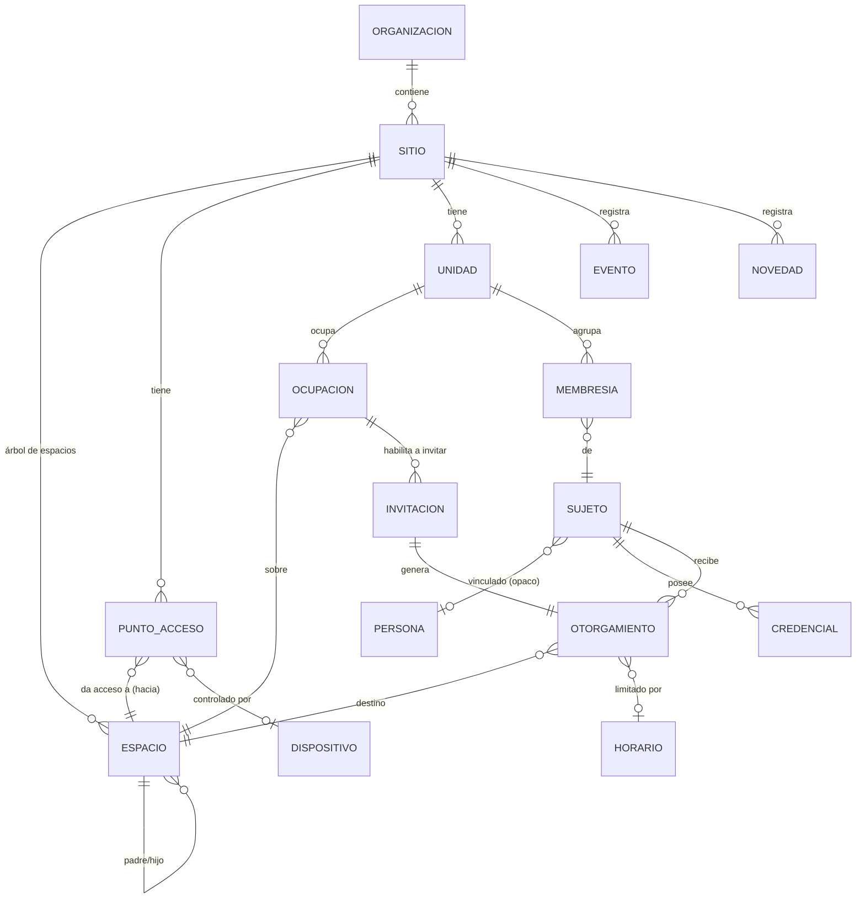

# 02 Dominio y modelo de datos

## Vista general



## Los conceptos clave

| Concepto | Qué es | Ejemplo |
|---|---|---|
| **Persona** | Identidad única en toda la plataforma (padrón). Datos cifrados, ningún tenant la ve. | Marcelo, DNI 30.123.456 |
| **Sujeto** | Representación local de alguien en un sitio. Es lo que usan todas las tablas operativas. Puede apuntar a una Persona o ser anónimo. | "Delivery 14:32" o el residente del 5B |
| **Unidad** | Entidad que ocupa un espacio y agrupa personas. | Familia, empresa, lote, departamento |
| **Espacio** | Nodo del árbol físico. | Sitio → Torre A → Piso 5 → Depto 5B |
| **Membresía** | Sujeto ↔ Unidad, con rol y vigencia. | Titular, cónyuge, hijo, empleado |
| **Ocupación** | Unidad ↔ Espacio, con rol y vigencia. | Propietario, inquilino, residente |
| **Otorgamiento** | Permiso único: Sujeto → Destino → Horario → Vigencia → Origen. | Empleada doméstica, 5B, L-V 8 a 17 |

> La clave de la privacidad: las tablas de negocio solo guardan `SujetoId`. Solo el módulo **People** conoce la relación Sujeto ↔ Persona, y nunca la expone a otros tenants (ver [06](06-privacidad-y-legal.md)).

## Árbol de espacios y puntos de acceso

- `Espacio` es un árbol (tabla con `padre_id` y un `path` tipo `ltree`). Tipos: sitio, torre, piso, unidad, área común, estacionamiento, etc.
- Un `PuntoAcceso` (puerta, portón, barrera, ascensor) tiene un solo atributo espacial importante: **hacia qué espacio da acceso**.
- **Derivación del camino a un destino:** los puntos permitidos para llegar al espacio *E* son todos los puntos cuyo `hacia` sea *E* o alguno de sus **ancestros**. Es una consulta sobre el árbol, sin grafos.

Ejemplo para llegar al Depto 5B:

```
Sitio (portón principal)  →  Torre A (puerta del hall)  →  Piso 5 (ascensor/puerta de piso)  →  5B (puerta del depto)
```

Un otorgamiento al **Hall** cubre solo el portón y la puerta del hall, no los pisos.

## Esquema por módulo

Cada módulo tiene su propio **schema** de PostgreSQL. Todas las tablas de los módulos con datos de negocio llevan `organizacion_id` (y `sitio_id` cuando corresponde), con RLS por tenant.

Los nombres de tablas y columnas de este documento están en español como referencia conceptual. En la base se usan en inglés, según la regla de identificadores del proyecto: `organizacion_id` es `organization_id`, `sitio_id` es `site_id`, y así con el resto. Los módulos ya implementados muestran sus nombres reales.

### Tenancy (implementado)

Schema `tenancy`.

| Tabla | Campos principales |
|---|---|
| `organization` | id, name, status (active), created_at. El plan comercial queda para un cambio posterior. |
| `site` | id, organization_id, type (building, gated_community, company, house), name (único por organización sin distinguir mayúsculas), time_zone (IANA), configuration (jsonb), created_at, updated_at |

`site` tiene la política RLS estándar por `organization_id`. `organization` tiene políticas propias: se lee y modifica solo la organización activa, y solo se crea en una operación de plataforma. Ver `openspec/specs/tenant-isolation`.

### Identity (implementado)

Schema `identity`.

| Tabla | Campos principales |
|---|---|
| `user_account` | id, email, normalized_email (único), password_hash, status (active, disabled), platform_operator, created_at. El vínculo con el Sujeto (`sujeto_ref`) llega con `add-people-registry`. |
| `membership` | id, organization_id, user_id (único por organización), created_at |
| `role_assignment` | id, organization_id, user_id, role (administrator, guard, resident, employee), scope_type (organization, site), scope_id, valid_from, valid_until, created_at |
| `invitation` | id, organization_id, normalized_email, role, scope_type, scope_id, token_hash, expires_at, accepted_at, accepted_by, created_by, created_at |
| `refresh_session` | id, user_id, active_organization_id, created_at, expires_at, revoked_at |
| `refresh_token` | id, session_id, user_id, token_hash, created_at, used_at |

`membership`, `role_assignment` e `invitation` tienen la política RLS estándar por `organization_id`; `membership` además deja ver al usuario sus propias membresías. `user_account`, `refresh_session` y `refresh_token` tienen RLS aislado por usuario: una cuenta sirve para varias organizaciones (D-04). Las búsquedas previas a la autenticación usan funciones `SECURITY DEFINER` acotadas. Los tokens se guardan solo como hash. Ver `openspec/specs/tenant-isolation` y `openspec/specs/authentication`.

El alcance por espacio (`scope_type` = space) llega con `add-spaces-and-access-points`. El operador de plataforma es una marca de la cuenta, no un rol de organización.

### People (padrón global, fuera de RLS)

| Tabla | Campos principales |
|---|---|
| `persona` | id (opaco), estado, creado_en |
| `persona_identificador` | persona_id, tipo_documento, pais_emisor, hash_hmac (índice único), valor_cifrado |
| `persona_dato_verificado` | persona_id, nombre_cifrado (para verificación en puerta por guardia) |
| `sujeto_vinculo` | sujeto_id, persona_id (solo lo ve el módulo People) |

### Spaces

| Tabla | Campos principales |
|---|---|
| `espacio` | id, sitio_id, padre_id, path, tipo, nombre, es_comun, modo_presencia (ninguno, suave, duro), aforo_max, cupo_invitados_unidad (reservado), restringir_por_morosidad |
| `punto_acceso` | id, sitio_id, nombre, hacia_espacio_id, desde_espacio_id (opcional), tipo, modo_fallo (fail_safe, fail_secure), dispositivo_id, canal |

### Occupancy

| Tabla | Campos principales |
|---|---|
| `sujeto` | id, sitio_id, tipo (persona, anonimo), alias, creado_por |
| `unidad` | id, sitio_id, tipo, nombre, estado_financiero (al_dia, moroso) |
| `ocupacion` | id, unidad_id, espacio_id, rol (propietario, inquilino, residente, titular_empresa), desde, hasta |
| `membresia` | id, unidad_id, sujeto_id, rol (titular, conyuge, hijo, empleado, ...), desde, hasta |
| `plantilla_acceso_rol` | sitio_id, rol_ocupacion, perfil_acceso_id, puede_invitar, acceso_puerta_unidad |
| `contacto` | id, owner_sujeto_id, sujeto_id, alias, telefono_cifrado, plantilla_horario_id |

### Access

| Tabla | Campos principales |
|---|---|
| `horario` | id, sitio_id, nombre, reglas (días y franjas, en zona horaria del sitio) |
| `perfil_acceso` | id, sitio_id, nombre |
| `perfil_acceso_item` | perfil_id, destino_tipo (espacio, punto), destino_id, horario_id, efecto (permitir, denegar) |
| `credencial` | id, sujeto_id, tipo (rf, tarjeta, ble, qr, pin), valor_hash, estado, desde, hasta |
| `otorgamiento` | id, sitio_id, sujeto_id, destino_tipo, destino_id, horario_id, desde, hasta, efecto, origen_tipo (ocupacion, invitacion, rol, manual), origen_id, usos_max, usos_restantes, estado |
| `invitacion` | id, ocupacion_id, creado_por_sujeto_id, sujeto_id, tipo (nominal, recurrente, temporal, guardia), destino_espacio_id, horario_id, desde, hasta, usos_max, estado, otorgamiento_id |

### Devices

| Tabla | Campos principales |
|---|---|
| `dispositivo` | id, sitio_id, tipo, modelo, firmware_version, estado, ultimo_contacto, version_politica, bateria, certificado_id |
| `comando` | id, dispositivo_id, tipo (abrir, sincronizar, reiniciar, ota), payload, estado, creado_en |
| `politica_compilada` | dispositivo_id, version, hash, blob_url, creado_en |

### Events

| Tabla | Campos principales |
|---|---|
| `evento` | id, sitio_id, ts, tipo, punto_acceso_id, sujeto_id, credencial_id, resultado, motivo. Particionada por mes. |
| `presencia` | sujeto_id, espacio_id, desde, expira_en, evento_id |
| `novedad` | id, sitio_id, tipo (invitado_vencido_sin_salir, puerta_forzada, dispositivo_offline, ...), estado (abierta, revisada, cerrada), referencias, creado_en, revisado_por |

## Cómo se resuelve "propietario con inquilino"

Dos unidades distintas pueden tener ocupación sobre el mismo espacio:

- **Unidad García** → ocupación `propietario` sobre 5B.
- **Unidad Pérez** → ocupación `inquilino` sobre 5B.

El rol efectivo de García pasa a `propietario_alquilado` mientras exista una ocupación `inquilino` activa sobre el mismo espacio. La plantilla de acceso de ese rol (configurable por sitio) define qué recibe. Valor por defecto:

| Derecho | Propietario con inquilino | Inquilino |
|---|---|---|
| Acceso al sitio y zonas comunes | Sí | Sí |
| Puerta de la unidad | No | Sí |
| Invitar | No | Sí |

Cuando se cierra la ocupación del inquilino, el propietario recupera todo automáticamente.
