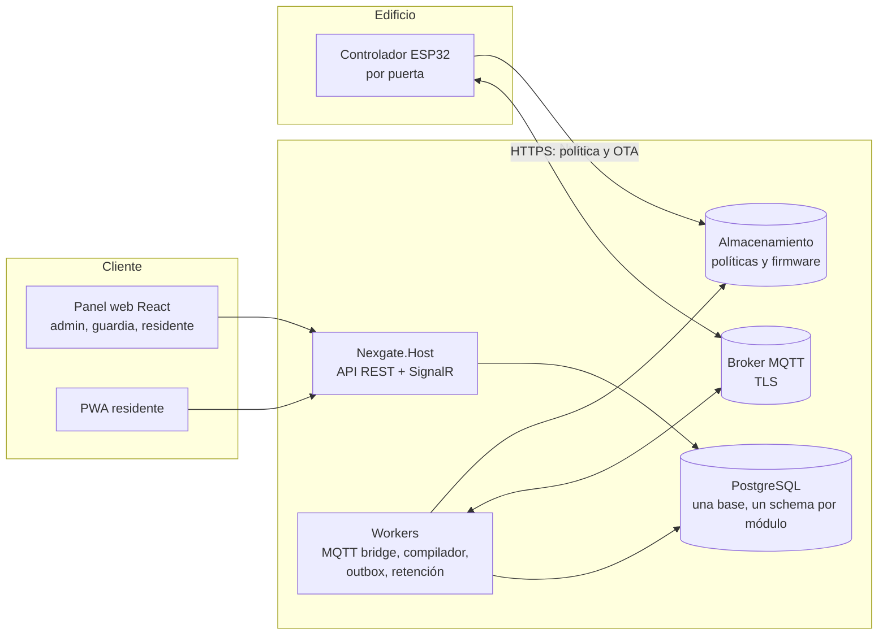

# 05 Arquitectura técnica

## Vista de componentes



## Monolito modular

Una sola aplicación .NET con módulos claros. Cada módulo es dueño de su **schema** en PostgreSQL y de su lógica. No hay joins entre módulos de distintos schemas: se comunican por **contratos** (interfaces) y **eventos de integración** con patrón **outbox**.

| Módulo | Responsabilidad |
|---|---|
| Tenancy | Organizaciones y sitios |
| Identity | Usuarios, login, roles por alcance |
| People | Padrón único, vínculos Sujeto↔Persona, derechos ARCO |
| Spaces | Árbol de espacios y puntos de acceso |
| Occupancy | Unidades, ocupaciones, membresías, plantillas, contactos |
| Access | Horarios, perfiles, credenciales, otorgamientos, invitaciones, evaluador y compilador |
| Devices | Dispositivos, comandos, políticas publicadas, firmware |
| Events | Eventos, presencia, novedades |
| Notifications | Mail, WhatsApp, SMS, push |
| Admin / Billing | Cuotas, uso, facturación (después) |

**Estructura de cada módulo** (para poder extraerlo como microservicio):

```
Modules/Access/
  Access.Contracts/        interfaces y eventos públicos
  Access.Domain/
  Access.Application/
  Access.Infrastructure/   EF Core, repositorios, migraciones del schema "access"
```

Los módulos solo se referencian por `*.Contracts`.

**Camino de crecimiento:**

1. Un solo proceso (API + workers) en un contenedor.
2. Separar **workers** (MQTT bridge, compilador, retención) como proceso aparte, mismo repositorio.
3. Extraer módulos con más carga (Events, Devices) como servicios, manteniendo la misma base y los mismos schemas.
4. Réplica de lectura, particionado de eventos y broker MQTT en clúster.

## Multitenancy

- Toda tabla de negocio lleva `organization_id` (los nombres de tablas y columnas van en inglés, Q-04).
- **Row-Level Security** en PostgreSQL como defensa principal. Dos roles: `nexgate_owner` corre las migraciones y es dueño de las tablas; `nexgate_app` es el de la aplicación, sin propiedad, sin `BYPASSRLS` y sin acceso al historial de migraciones. La API nunca migra al arrancar (`dotnet run --project src/Nexgate.Host -- migrate`).
- Un interceptor de EF Core fija la organización activa en la sesión cada vez que abre una conexión (`set_config('app.org_id', ..., false)`), y la deja vacía si no hay organización activa. Npgsql reinicia el estado de la sesión al devolver la conexión al pool, así que una conexión reutilizada no conserva la organización anterior.
- Sin organización activa no se ve nada: `public.nexgate_current_org()` devuelve NULL y ninguna fila cumple la política (falla cerrado).
- Además, **filtros globales de EF Core** como segunda barrera: el `DbContext` base filtra las entidades marcadas como de una organización, les asigna la organización activa al crearlas y rechaza cualquier cambio de organización.
- Una prueba de catálogo falla si alguna tabla de negocio no tiene RLS habilitado, forzado y con política.

```sql
ALTER TABLE access.grant ENABLE ROW LEVEL SECURITY;
ALTER TABLE access.grant FORCE ROW LEVEL SECURITY;

CREATE POLICY tenant_isolation ON access.grant
  USING (organization_id = public.nexgate_current_org())
  WITH CHECK (organization_id = public.nexgate_current_org());
```

Las migraciones lo generan con `migrationBuilder.EnableTenantIsolation(schema, tabla)` y `GrantAppAccess(schema)`.

- La organización activa sale del claim `org_id` del usuario autenticado. Hasta que exista identidad, hay un mecanismo de desarrollo (encabezado `X-Nexgate-Organization`, `Tenancy:DevelopmentAccess:Enabled`) que está apagado por defecto y que impide arrancar fuera de `Development`.
- El **padrón** (módulo People) es la única excepción: vive fuera de RLS y solo se accede por un servicio con API estrecha (`ResolverSujeto(documento) → sujetoId`), con un rol de base de datos propio.
- El acceso por **sitio** y por **espacio** se resuelve en la capa de aplicación con las asignaciones de rol.

## Identidad y autorización

- **OpenIddict** (OIDC) o Keycloak si se prefiere un servidor externo. Tokens con la organización activa como claim.
- Un usuario puede pertenecer a varias organizaciones (selector al ingresar).
- Autorización por **permisos granulares** evaluados en el backend contra `asignacion_rol` y alcance. La interfaz solo refleja lo que el endpoint `GET /me/permissions` devuelve.
- Los dispositivos usan una autenticación aparte (certificado o token por dispositivo).

## API y tiempo real

- **REST** con OpenAPI y versionado. Cliente TypeScript generado desde el contrato.
- **SignalR** para estado de puertas, eventos en vivo y novedades, con un grupo por sitio.
- **Ingesta de eventos idempotente** (id de evento generado por el dispositivo).
- Las operaciones largas (compilación, recálculo masivo) se disparan por eventos y las procesan los workers.

## Base de datos

- **PostgreSQL**: relacional, ideal para permisos y jerarquías, con RLS y particionado.
- `evento` **particionada por mes** (la retención se aplica borrando particiones).
- `espacio` con `ltree` para consultas de ancestros.
- Opciones gratuitas o económicas en la nube: Neon, Supabase o Azure Database for PostgreSQL (nivel burstable). **Verificar límites y precios vigentes antes de decidir**, porque cambian seguido.
- Cosmos DB se descarta para este caso: el modelo es fuertemente relacional.
- Redis, solo cuando haga falta (caché o backplane de SignalR al escalar a más de una instancia).

## Frontend

- **React + TypeScript**, Vite, TanStack Query, React Router.
- Una sola aplicación con navegación y pantallas por permiso:
  - **Administrador:** sitios, espacios, puertas, dispositivos, unidades, residentes, reglas, novedades, reportes.
  - **Guardia:** eventos en vivo, aperturas, visitas, accesos temporales.
  - **Residente o empleado:** mi unidad, mis invitados y libreta, mis accesos, historial.
- **PWA** para residentes (invitar en segundos, mostrar QR). App nativa más adelante si se necesita BLE.
- i18n desde el inicio (interfaz en español).
- Biblioteca de componentes a elegir (MUI o shadcn/ui con Tailwind).

## Observabilidad y operación

- **OpenTelemetry** (trazas, métricas, logs estructurados), con un identificador de tenant en cada traza.
- Métricas de dispositivos: último contacto, versión de política, batería, tasa de errores.
- Alertas hacia **Novedades** para dispositivos sin conexión.
- Backups automáticos de la base y prueba periódica de restauración.

## Pruebas

- Pruebas unitarias del dominio (evaluador y compilador).
- Pruebas de integración con PostgreSQL real, incluyendo las políticas RLS. La cadena de conexión sale de `ConnectionStrings:Default` o de la variable `NEXGATE_TEST_PG`, de modo que sirve tanto con `docker-compose` como con un PostgreSQL instalado (Testcontainers queda como opción futura para CI).
- Pruebas de arquitectura: las reglas de dependencia entre proyectos (módulos solo por `*.Contracts`, `Domain` sin paquetes ni frameworks, `BuildingBlocks` sin módulos) se verifican leyendo los `.csproj`, así fallan aunque la referencia todavía no se use en el código.
- **Vectores de prueba compartidos** entre el evaluador de C# y el del firmware, para garantizar que ambos decidan lo mismo.
- **Simulador de dispositivos** (cliente MQTT en .NET) para probar sincronización y eventos sin hardware.

## Hosting inicial (barato y escalable)

| Componente | Opción inicial |
|---|---|
| API y workers | Azure Container Apps (escala a cero) o un VPS con Docker Compose |
| Base de datos | PostgreSQL administrado económico (ver arriba) |
| Broker MQTT | Mosquitto o EMQX en un VPS pequeño, con TLS |
| Almacenamiento de políticas y firmware | Azure Blob Storage o equivalente |
| Frontend | Hosting estático o contenedor |

## Estructura propuesta del repositorio

```
nexgate/
  docs/
  src/
    Nexgate.Host/              composición, API, SignalR
    Nexgate.Workers/           MQTT bridge, compilador, outbox, retención
    BuildingBlocks/            outbox, tenancy, mensajería, utilidades
    Modules/                   un directorio por módulo (ver arriba)
  web/                         React + TypeScript
  firmware/                    ESP32
  infra/                       Docker Compose, IaC, scripts
  tests/
```
