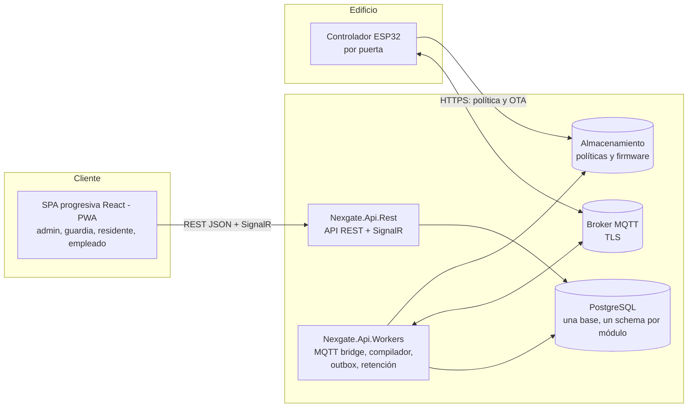

# 05 Arquitectura técnica

## Vista de componentes



## Monolito modular

Una sola aplicación .NET con módulos claros. Cada módulo es dueño de su **schema** en PostgreSQL y de su lógica. No hay joins entre módulos de distintos schemas: se comunican por **contratos** (interfaces) y **eventos de integración** con patrón **outbox**.

| Módulo | Responsabilidad |
|---|---|
| Tenancy | Organizaciones y sitios |
| Identity | Usuarios, login, roles por alcance |
| People | Padrón único, vínculos Sujeto↔Persona, derechos ARCO |
| Spaces | Árbol de espacios y puntos de acceso |
| Occupancy | Unidades, ocupaciones, membresías, plantillas, contactos |
| Access | Horarios, perfiles, credenciales, otorgamientos, invitaciones, evaluador y compilador |
| Devices | Dispositivos, comandos, políticas publicadas, firmware |
| Events | Eventos, presencia, novedades |
| Notifications | Mail, WhatsApp, SMS, push |
| Admin / Billing | Cuotas, uso, facturación (después) |

**Estructura de cada módulo** (D-32): la solución sigue las capas numeradas de SMT y cada módulo tiene un proyecto en cada capa que necesita, para poder extraerlo como microservicio:

```
src/03.Service/Nexgate.Service.Access.Contracts/   interfaces de servicio, DTOs, nombres públicos, códigos de error y eventos públicos
src/03.Service/Nexgate.Service.Access/             servicios de aplicación (internal), lo que cruza módulos y registro DI
src/04.Data/Nexgate.Data.Access/                   EF Core, stores y sus interfaces (puertos), migraciones del schema "access"
src/05.Domain/Nexgate.Domain.Access/               entidades y reglas puras
src/02.Api/Nexgate.Api.Rest/Controllers/Access/    controllers del módulo
src/02.Api/Nexgate.Api.Rest/Models/Access/         modelos de solicitud HTTP con su validación
```

Tenancy, Identity y Spaces ya siguen esta estructura (`integrate-modules-into-layers`, `add-spaces-and-access-points`).

Sentido de dependencias: `Api → Service → Data → Domain`, con `Common` disponible para `Service`, `Data` y los procesos. Cualquier capa de un módulo puede usar el `Contracts` de su propio módulo (por ejemplo, `Domain.Identity` usa los nombres de roles y permisos); `Contracts` no referencia nada. Entre módulos, solo `Service.<M> → Service.<Otro>.Contracts`: `Domain` y `Data` no ven a otros módulos. La persistencia de un módulo solo la usa su capa de servicio. Cuando un store necesita verificar algo de otro módulo dentro de su transacción, define un puerto propio que implementa su servicio con los contratos del otro módulo (por ejemplo, `IOrganizationReferences` en `Data.Identity`). Al revés, cuando un módulo necesita saber si otros usan uno de sus datos, define el puerto en su `Contracts` y los demás lo implementan (por ejemplo, `ISpaceUsage` de Spaces, que implementa Identity para no eliminar un espacio usado como alcance de un rol). Ningún proyecto de módulo usa el framework web. La API referencia las capas internas únicamente para componerlas (`Extensions/ModuleExtensions.cs`, la autenticación y el límite de intentos); sus controllers solo usan los contratos y sus propios modelos de solicitud (D-33).

**Camino de crecimiento:**

1. Un solo proceso (API + workers) en un contenedor.
2. Separar **workers** (MQTT bridge, compilador, retención) como proceso aparte, mismo repositorio.
3. Extraer módulos con más carga (Events, Devices) como servicios, manteniendo la misma base y los mismos schemas.
4. Réplica de lectura, particionado de eventos y broker MQTT en clúster.

## Multitenancy

- Toda tabla de negocio lleva `organization_id` (los nombres de tablas y columnas van en inglés, Q-04).
- **Row-Level Security** en PostgreSQL como defensa principal. Dos roles: `nexgate_owner` corre las migraciones y es dueño de las tablas; `nexgate_app` es el de la aplicación, sin propiedad, sin `BYPASSRLS` y sin acceso al historial de migraciones. La API nunca migra al arrancar (`dotnet run --project src/02.Api/Nexgate.Api.Rest -- migrate`).
- Un interceptor de EF Core fija la organización activa y el usuario actual en la sesión cada vez que abre una conexión (`set_config('app.org_id', ...)` y `set_config('app.user_id', ...)`), y los deja vacíos si no hay valor. Npgsql reinicia el estado de la sesión al devolver la conexión al pool, así que una conexión reutilizada no conserva los de una solicitud anterior.
- Sin organización activa no se ve nada: `public.nexgate_current_org()` devuelve NULL y ninguna fila cumple la política (falla cerrado). `public.nexgate_current_user()` cumple el mismo papel para los datos aislados por usuario.
- Además, **filtros globales de EF Core** como segunda barrera: el `DbContext` base filtra las entidades marcadas como de una organización, les asigna la organización activa al crearlas y rechaza cualquier cambio de organización.
- Una prueba de catálogo falla si alguna tabla de negocio no tiene RLS habilitado, forzado y con política.

```sql
ALTER TABLE access.grant ENABLE ROW LEVEL SECURITY;
ALTER TABLE access.grant FORCE ROW LEVEL SECURITY;

CREATE POLICY tenant_isolation ON access.grant
  USING (organization_id = public.nexgate_current_org())
  WITH CHECK (organization_id = public.nexgate_current_org());
```

Las migraciones lo generan con `migrationBuilder.EnableTenantIsolation(schema, tabla)` y `GrantAppAccess(schema)`.

- La organización activa sale solo del claim `org_id` del token, y vale solo si el usuario tiene una membresía activa en ella. Ningún encabezado ni parámetro la puede fijar.
- Los datos de identidad que no pertenecen a una sola organización (`identity.user_account`, `identity.refresh_session`, `identity.refresh_token`) tienen RLS habilitado y forzado, aislado por usuario: cada uno ve lo suyo y un administrador ve las cuentas de los miembros de su organización. No son datos de negocio de un tenant (una cuenta sirve para varias organizaciones, D-04).
- Antes de autenticar no hay usuario ni organización. Las búsquedas de ese momento (cuenta por correo, token de renovación, invitación) usan funciones `SECURITY DEFINER` que devuelven una sola fila por clave exacta, fijan `search_path` y solo las ejecuta `nexgate_app`. La prueba de catálogo rechaza cualquier otra.
- Los flujos que actúan en nombre de otro usuario u organización (inicio de sesión, aceptar una invitación, nombres del selector) crean un alcance de DI con ese usuario y esa organización (`IContextScopeFactory`), después de verificar que corresponde. RLS hace el resto.
- El **padrón** (módulo People) es la única excepción: vive fuera de RLS y solo se accede por un servicio con API estrecha (`ResolverSujeto(documento) → sujetoId`), con un rol de base de datos propio.
- El acceso por **sitio** y por **espacio** se resuelve en la capa de aplicación con las asignaciones de rol: cada permiso efectivo lleva su alcance (organización, sitio entero o espacio con su subárbol) y cada controller lo aplica sobre el recurso (`ICurrentPermissions.ScopeFor`).

## Identidad y autorización

- **Tokens propios** (módulo Identity): `POST /api/v1/auth/token` valida correo y contraseña y emite un token de acceso JWT ES256 de 15 minutos (`sub`, `org_id`, `sid`; sin correo, roles ni permisos) y un token de renovación opaco que rota en cada uso. Reutilizar un token ya rotado revoca la sesión entera. OpenIddict queda como opción si aparecen clientes de terceros o proveedores externos; el contrato del token no cambia.
- Contraseñas con el hash PBKDF2 de ASP.NET Core Identity, de al menos 12 caracteres. Una cuenta inexistente responde igual que una contraseña equivocada, y los intentos se limitan por IP.
- Un usuario puede pertenecer a varias organizaciones: con una sola membresía queda elegida al iniciar sesión; con varias, el cliente elige al iniciar sesión o al renovar (`organizationId`).
- Cada acción de un controller declara exactamente un requisito de acceso con un atributo (`[RequireAuthenticatedUser]`, `[RequirePermission]`, `[RequirePlatformOperator]` o `[AnonymousAccess]`); una prueba de arquitectura lo verifica, así que ninguna acción queda pública por omisión. Los atributos responden 401 `authentication_required`, 403 `organization_context_required` o 403 `permission_denied`.
- Autorización por **permisos granulares** evaluados en el servidor en cada solicitud a partir de las asignaciones de rol vigentes de la organización activa (`identity.role_assignment`: rol, alcance de organización, sitio o espacio, vigencia). Quitar un rol o una membresía tiene efecto en la solicitud siguiente aunque el token siga vigente. La interfaz solo refleja lo que devuelve `GET /api/v1/me/permissions`.
- Estos permisos son administrativos, sobre la API. El acceso físico es exclusivo del motor de Otorgamientos.
- El operador de plataforma (alta de organizaciones) se marca en la cuenta y se lee de la base en cada solicitud. El primero se crea con `dotnet run --project src/02.Api/Nexgate.Api.Rest -- create-platform-operator --email <correo>`.
- Los dispositivos usan una autenticación aparte (certificado o token por dispositivo).

## API y tiempo real

- **REST** con controllers (`[ApiController]`, D-33), versionado por segmento de URL (`api/v{version}`) y OpenAPI. El contrato es el documento OpenAPI 3.1 versionado en `api/nexgate-v1.openapi.json` (D-34); el frontend genera desde ahí su cliente o proxy TypeScript, sin levantar el backend.
  - Lo genera el generador oficial de .NET (`Microsoft.AspNetCore.OpenApi`) a partir de los controllers de la API REST (explorador de API de ASP.NET Core) y de los atributos de cada acción: nombre de operación estable, resumen en español, esquemas, todas las respuestas de error (formato estándar con `code` y `correlationId`) y el requisito de token.
  - Una prueba compara el documento generado con el versionado, y otra verifica que toda respuesta producida por las pruebas de integración esté declarada.
  - Swagger UI (`/swagger`) y el documento (`/openapi/v1.json`) se sirven solo en `Development`.
- **SignalR** para estado de puertas, eventos en vivo y novedades, con un grupo por sitio.
- **Ingesta de eventos idempotente** (id de evento generado por el dispositivo).
- Las operaciones largas (compilación, recálculo masivo) se disparan por eventos y las procesan los workers.

## Base de datos

- **PostgreSQL**: relacional, ideal para permisos y jerarquías, con RLS y particionado.
- `evento` **particionada por mes** (la retención se aplica borrando particiones).
- `espacio` con `ltree` para consultas de ancestros.
- Opciones gratuitas o económicas en la nube: Neon, Supabase o Azure Database for PostgreSQL (nivel burstable). **Verificar límites y precios vigentes antes de decidir**, porque cambian seguido.
- Cosmos DB se descarta para este caso: el modelo es fuertemente relacional.
- Redis, solo cuando haga falta (caché o backplane de SignalR al escalar a más de una instancia).

## Frontend

- **React + TypeScript**, Vite, TanStack Query, React Router.
- Toda la aplicación web es una sola **SPA progresiva (PWA)**: se instala en el celular o la computadora, carga sin recargar páginas y consume solo la API REST (el backend no renderiza HTML). Navegación y pantallas por permiso:
  - **Administrador:** sitios, espacios, puertas, dispositivos, unidades, residentes, reglas, novedades, reportes.
  - **Guardia:** eventos en vivo, aperturas, visitas, accesos temporales.
  - **Residente o empleado:** mi unidad, mis invitados y libreta, mis accesos, historial.
- Como PWA, funciona igual para todos los roles; para residentes prioriza lo rápido desde el celular (invitar en segundos, mostrar QR). App nativa más adelante si se necesita BLE.
- i18n desde el inicio (interfaz en español).
- Biblioteca de componentes a elegir (MUI o shadcn/ui con Tailwind).

## Observabilidad y operación

- **OpenTelemetry** (trazas, métricas, logs estructurados), con un identificador de tenant en cada traza.
- Métricas de dispositivos: último contacto, versión de política, batería, tasa de errores.
- Alertas hacia **Novedades** para dispositivos sin conexión.
- Backups automáticos de la base y prueba periódica de restauración.

## Pruebas

- Pruebas unitarias del dominio (evaluador y compilador).
- Pruebas de integración con PostgreSQL real, incluyendo las políticas RLS. La cadena de conexión sale de `ConnectionStrings:Default` o de la variable `NEXGATE_TEST_PG`, de modo que sirve tanto con `docker-compose` como con un PostgreSQL instalado (Testcontainers queda como opción futura para CI).
- Pruebas de arquitectura (`src/07.Test/Nexgate.Test.Architecture`): las reglas de dependencia entre proyectos (sentido `Api → Service → Data → Domain`, `Contracts` del propio módulo desde cualquier capa, entre módulos solo `Service → *.Contracts`, `Data` solo desde su servicio, `Domain` y `Contracts` sin paquetes, módulos y `Common` sin el framework web, `Common` sin módulos ni procesos) se verifican leyendo los `.csproj`, así fallan aunque la referencia todavía no se use en el código. Por reflexión se verifica que los controllers solo usen tipos de `*.Contracts`, de `Common`, del framework o de `Nexgate.Api.Rest.Models`, y que toda acción declare exactamente un requisito de acceso.
- **Vectores de prueba compartidos** entre el evaluador de C# y el del firmware, para garantizar que ambos decidan lo mismo.
- **Simulador de dispositivos** (cliente MQTT en .NET) para probar sincronización y eventos sin hardware.

## Hosting inicial (barato y escalable)

| Componente | Opción inicial |
|---|---|
| API y workers | Azure Container Apps (escala a cero) o un VPS con Docker Compose |
| Base de datos | PostgreSQL administrado económico (ver arriba) |
| Broker MQTT | Mosquitto o EMQX en un VPS pequeño, con TLS |
| Almacenamiento de políticas y firmware | Azure Blob Storage o equivalente |
| Frontend | Hosting estático o contenedor |

## Estructura propuesta del repositorio

```
nexgate/
  api/                                contrato OpenAPI versionado (D-34)
  docs/
  src/                                capas numeradas (D-32)
    01.Client/                        SPA progresiva React + TypeScript (llega con add-admin-panel-shell)
    02.Api/
      Nexgate.Api.Rest/               composición, controllers, middlewares, SignalR
      Nexgate.Api.Workers/            MQTT bridge, compilador, outbox, retención
    03.Service/                       Nexgate.Service.<Modulo> y Nexgate.Service.<Modulo>.Contracts
    04.Data/                          Nexgate.Data.<Modulo>
    05.Domain/                        Nexgate.Domain.<Modulo>
    06.Common/
      Nexgate.Common.BuildingBlocks/  contexto de seguridad, persistencia compartida (RLS), telemetría, salud; luego outbox y mensajería (sin dependencias HTTP)
    07.Test/                          pruebas de la API y de arquitectura
  firmware/                           ESP32
  infra/                              Docker Compose, IaC, scripts
```
